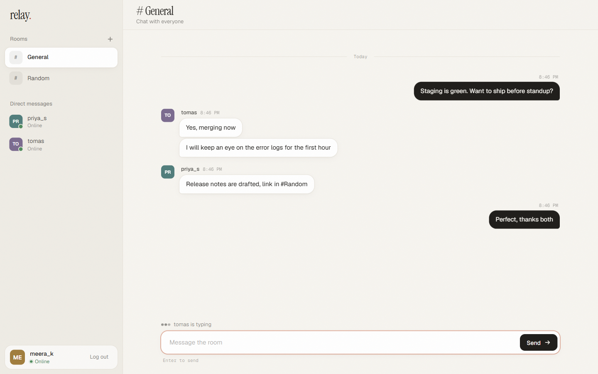
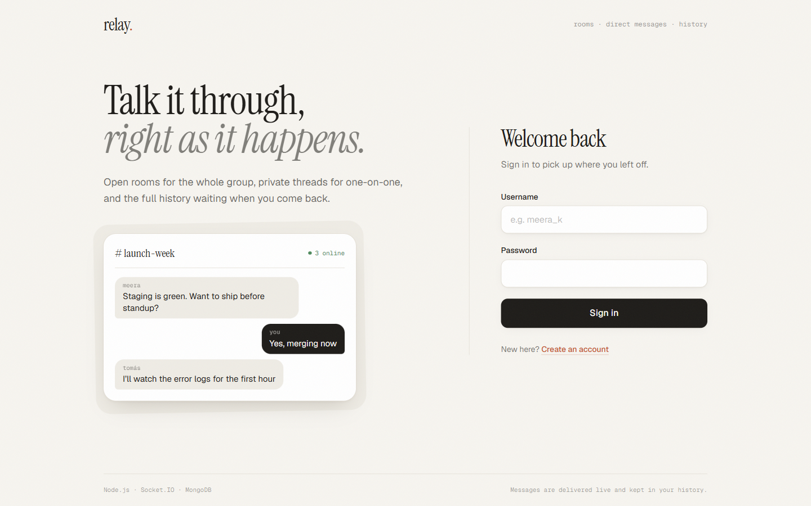
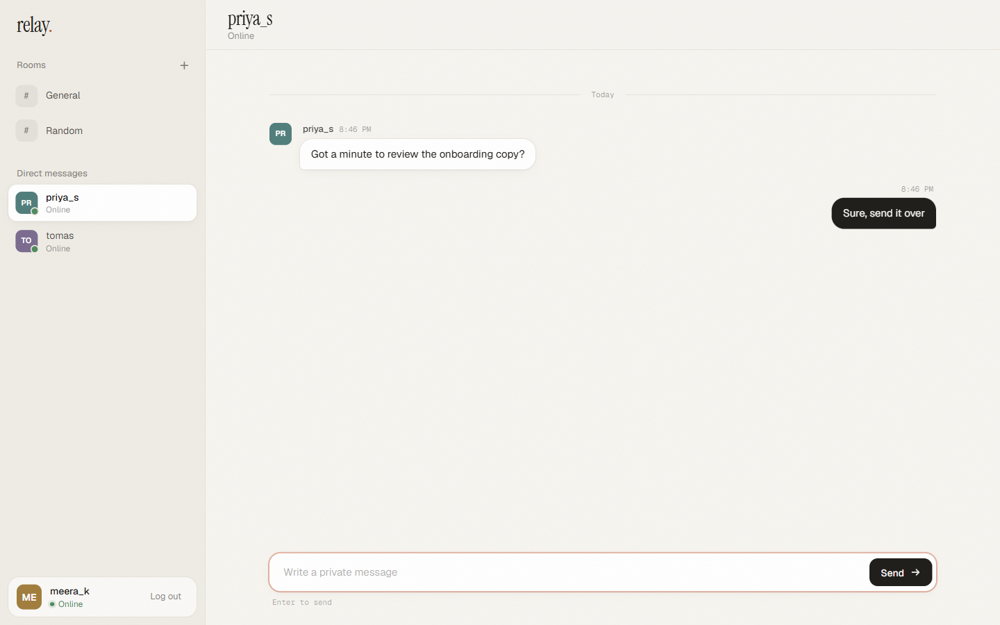
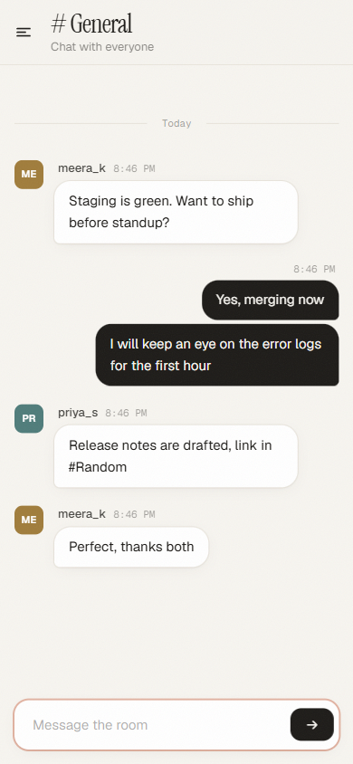

# Relay — Real-Time Chat App

A real-time chat app with group rooms, private messages, saved chat history, typing indicators and online status.

**Stack:** Node.js · Express · Socket.IO · MongoDB (Mongoose) · JWT · bcrypt · Tailwind CSS



| Sign in | Direct message | Mobile |
|---|---|---|
|  |  |  |

## Features

- **Accounts:** register and log in with a username and password. Passwords are hashed with bcrypt, and sessions use JWT.
- **Group rooms:** General and Random are created automatically, and anyone can create more.
- **Private messages:** one-to-one conversations, delivered only to the two people involved.
- **Chat history:** messages are saved in MongoDB and load 50 at a time; scroll up for older ones.
- **Typing indicators** in rooms and private chats.
- **Online / offline status** with a "last seen" time. A user with several tabs open counts as one person.
- **Unread badges** for conversations you aren't looking at.
- **Reconnects automatically:** if the server restarts, the page reconnects and reloads its data.
- **Responsive layout** that works on mobile.

## Quick start

You need **Node.js 22+**.

```bash
npm install
cp .env.example .env      # Windows: copy .env.example .env
npm start
```

Open http://localhost:3000 and create an account. Then open a second browser (or a private window), create another account, and chat between the two.

With `MONGO_URI` left empty, the app starts a temporary in-memory MongoDB, so no database setup is needed. Data is lost when the server stops.

### Configuration (`.env`)

| Variable | Default | Description |
|---|---|---|
| `PORT` | `3000` | HTTP port |
| `MONGO_URI` | *(empty)* | MongoDB connection string. Empty means a temporary in-memory database. Local example: `mongodb://127.0.0.1:27017/chatapp`. Atlas: `mongodb+srv://<user>:<password>@<cluster>.mongodb.net/chatapp` |
| `JWT_SECRET` | — | Secret used to sign login tokens. **Use a long random string.** |
| `JWT_EXPIRES_IN` | `7d` | How long a login lasts |
| `AUTH_RATE_LIMIT` | `10` | Failed login/register attempts allowed per IP every 15 minutes |

If you use MongoDB Atlas, add your machine's IP address under **Network Access**, or the server can't connect.

## Tests

```bash
npm test
```

There are 25 automated tests, using Node's built-in test runner. Each test file starts the real server against its own in-memory MongoDB and talks to it over HTTP and Socket.IO, exactly like a browser would. No database setup is needed.

| File | What it covers |
|---|---|
| `test/api.test.js` | Register/login rules, case-insensitive usernames, NoSQL-injection attempts, token checks, rooms, history validation |
| `test/socket.test.js` | Socket authentication, room and private message delivery (and that a third user can't read a private message), persistence, typing, presence, message flood limit, malformed events not crashing the server |
| `test/rate-limit.test.js` | Brute-force protection on login |

## Security

- Passwords are stored as **bcrypt hashes** and are never returned by the API.
- **A JWT is required** for every API call and every socket connection. Socket connections also check that the account still exists.
- **Brute-force protection:** failed logins and sign-ups are limited per IP, and the server returns `429` with a `Retry-After` header.
- **Message flood protection:** at most 10 messages per 5 seconds per connection.
- **Input validation:**
  - credentials must be plain strings, which blocks `{ "$ne": null }`-style NoSQL injection
  - IDs and dates are checked before they reach the database
  - messages are trimmed and capped at 1000 characters
  - request bodies are capped at 10 kB
- **XSS-safe rendering:** user text is always inserted with `textContent`, never as HTML.
- **Crash-safe socket handlers:** malformed events or database errors are reported back to the client instead of taking the server down.
- **Security headers:** `X-Content-Type-Options`, `X-Frame-Options`, `Referrer-Policy`.
- **Generic login error:** a wrong password and an unknown username get the same message, so attackers can't find out which usernames exist.

## Project structure

```
server.js                Express + Socket.IO setup, DB connection, static files
models/                  Mongoose schemas: User, Room, Message (with indexes for history)
middleware/auth.js       JWT sign/verify + Express auth middleware
middleware/rateLimit.js  Small in-memory rate limiter (no dependency)
routes/auth.js           POST /register, POST /login, GET /me
routes/chat.js           Users, rooms, message history
socket/index.js          All real-time events
socket/presence.js       Tracks who is online (supports multiple tabs per user)
public/                  Frontend: sign-in page, chat page, JS, compiled CSS
styles/input.css         Tailwind source (compiled to public/css/styles.css)
test/                    Automated tests
docs/screenshots/        Screenshots used in this README
```

## REST API

All routes except register, login and health need `Authorization: Bearer <token>`.

| Method | Route | Description |
|---|---|---|
| GET | `/api/health` | Health check, `{ status: "ok" }` |
| POST | `/api/auth/register` | Create account `{ username, password }`, returns `{ token, user }` |
| POST | `/api/auth/login` | Log in, returns `{ token, user }` |
| GET | `/api/auth/me` | Current user |
| GET | `/api/users` | All other users, with an online flag |
| GET | `/api/rooms` | All rooms |
| POST | `/api/rooms` | Create room `{ name, description }` |
| GET | `/api/messages/room/:roomId?before=<ISO date>` | Room history (50 per page) |
| GET | `/api/messages/dm/:userId?before=<ISO date>` | Private chat history (50 per page) |

## Socket.IO events

The connection is authenticated with the JWT: `io({ auth: { token } })`. Events that take a callback reply with `{ ok: true }` or `{ error }`.

| Client → Server | Server → Client |
|---|---|
| `join_room(roomId, ack)` | `online_users([userIds])` |
| `leave_room(roomId)` | `user_online({ userId, username })` / `user_offline({ userId, lastSeen })` |
| `room_message({ roomId, text }, ack)` | `room_message(message)` |
| `private_message({ to, text }, ack)` | `private_message(message)` |
| `typing` / `stop_typing({ roomId } or { to })` | `typing` / `stop_typing` |
| | `room_created(room)` |

## Design decisions

- **One `messages` collection** holds both room and private messages (`room` or `recipient` is set), with compound indexes for both kinds of history query.
- **Cursor-based paging** (`?before=<date>`) instead of page numbers, so new messages arriving don't shift the pages.
- **Messages are saved before they're broadcast,** so everything a user sees is also in their history.
- **Private messages go to per-user channels** (`user:<id>`), so all of a user's open tabs receive them.
- **Scaling note:** presence and rate-limit counters are kept in memory, which suits a single server. To run several instances, add the Socket.IO Redis adapter and move those counters to Redis.

## Changing styles

The CSS is prebuilt in `public/css/styles.css`. If you edit Tailwind classes in the HTML or JS, rebuild it:

```bash
npm run build:css     # or: npm run watch:css while editing
```
